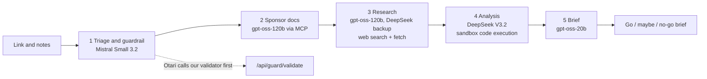

# Kestrel: scout a bounty before you build

> Paste a hackathon or bounty link. Kestrel reads the rules, researches the sponsor, works out the deadline and effort numbers with real code, and returns a **go, maybe or no-go brief** in about three minutes. Every stage is a separate call to a different open-weight model through the hosted [Otari](https://otari.ai) gateway.

**Live app:** https://kestrel-inky-psi.vercel.app (no sign-up, no access code)  
**Built for:** Developers Wilding: Online, the Otari hackathon by Mozilla.ai ([event page](https://dorahacks.io/hackathon/mozilla-devs-wilding))  
**Branch for judging:** `hackathon` · **License:** MIT

You do not need to open the site to understand the project. This page explains what Kestrel does, how each Otari feature is used (with links to the exact lines of code), what we measured, what was hard, and where we want to take it.

## Contents
1. [The problem](#1-the-problem)
2. [What Kestrel does](#2-what-kestrel-does)
3. [How it works](#3-how-it-works)
4. [How we use Otari](#4-how-we-use-otari-feature-by-feature)
5. [Open-weight models](#5-open-weight-models)
6. [Evidence it really works](#6-evidence-it-really-works)
7. [Feedback for the Otari team](#7-feedback-for-the-otari-team)
8. [Issues we opened on Otari](#8-issues-we-opened-on-otari)
9. [Plans: where Kestrel goes next and how it earns money](#9-plans-where-kestrel-goes-next-and-how-it-earns-money)
10. [Run it yourself](#10-run-it-yourself)
11. [Security and honest limitations](#11-security-and-honest-limitations)
12. [Repository map](#12-repository-map)

---

## 1. The problem
People who chase hackathons and bounties for income lose days on the wrong ones. The facts that decide whether to enter (the real deadline, who is eligible, what is mandatory, the prize, whether the sponsor's tool is even usable) are scattered over JavaScript-heavy pages, rules documents and sponsor repositories. Nobody reads them twice, and a missed rule means a wasted week.

## 2. What Kestrel does
You paste a link (and optionally the page text). Kestrel returns a one-page brief:

- a **verdict**: go, maybe or no-go
- the **deadline** and the **days remaining**, computed by code, not guessed
- prizes, mandatory requirements, eligibility flags and risks
- a plain **"still unknown"** list: anything it could not verify stays unknown, and it never invents a win probability

Example, from a real run on the page for the Otari hackathon itself:

| Field | Result |
|---|---|
| Verdict | Maybe |
| Deadline | 2026-11-11 22:59 UTC |
| Prize pool | $1,200 plus mentoring hours |
| Must use | Mozilla Otari |
| Effort | Unknown (not stated by any source) |

The app shows its work. For every stage you see the model that answered, its provider, latency, cost, whether a fallback happened, the gateway tool calls that ran (including the sandbox code and its output) and the guardrail verdict. Nothing is mocked. If a tool is unavailable, the stage says so.

## 3. How it works

Five stages, each its own Otari call, each a different role:



1. **Triage and guardrail.** Before any model sees your text, Otari sends it to Kestrel's own validator. A prompt-injection attempt is blocked with HTTP 403 and the run stops. Otherwise Mistral Small plans what must be verified.
2. **Sponsor docs.** `gpt-oss-120b` asks the sponsor's GitHub repository a question through a managed MCP server (DeepWiki) that the Otari gateway runs for us.
3. **Research.** `gpt-oss-120b` searches the web and fetches the official pages. The call goes through an Otari routing policy that falls back to DeepSeek V3.2.
4. **Analysis.** DeepSeek V3.2 writes Python that runs in Otari's code sandbox: days left to the deadline, prize per day of effort. The deadline countdown is computed from the current UTC time, not estimated by the model.
5. **Brief.** `gpt-oss-20b` writes strict JSON, and the UI renders it. Whatever could not be verified is marked unknown.

The browser talks only to our server route (`POST /api/scout`, streamed as NDJSON). Otari keys never reach the browser.

## 4. How we use Otari, feature by feature

We used eight of the rubric's features. Each one is used by a real run, not just switched on in a dashboard. The code links are permalinks to the exact lines.

| # | Otari feature | What we do with it | Code | Evidence in the app |
|---|---|---|---|---|
| 1 | **Multiple models in distinct roles** | Five stages, each with its own model and job | [`lib/pipeline.ts` L11 to L22](https://github.com/Nailer/kestrel/blob/db35ae8/lib/pipeline.ts#L11-L22) | Pipeline panel shows model, provider and cost per stage |
| 2 | **Model routing and fallbacks** | The research stage calls the named Otari routing policy `kestrel-research` (`gpt-oss-120b` first, `DeepSeek V3.2` as backup). Otari's own provider failover also served real calls (`otari-fallback: true`, DeepInfra then OVHcloud after an upstream 429). Separately, our code fails over to another model if one returns an empty answer. | [`lib/pipeline.ts` L210 to L237](https://github.com/Nailer/kestrel/blob/db35ae8/lib/pipeline.ts#L210-L237) | "Called through Otari routing policy kestrel-research" plus the model that served it |
| 3 | **MCP integration** | A managed DeepWiki MCP server (`https://mcp.deepwiki.com/mcp`, tool `ask_wiki_question`) answers questions about the sponsor's repo | [`lib/pipeline.ts` L130 to L137](https://github.com/Nailer/kestrel/blob/db35ae8/lib/pipeline.ts#L130-L137) | `otari_tool_calls` entry of type `mcp`, status `completed`, expandable |
| 4 | **Web search and web fetch** | The gateway runs `otari_web_search` and `otari_web_fetch` for the research stage | [`lib/pipeline.ts` L188 to L189](https://github.com/Nailer/kestrel/blob/db35ae8/lib/pipeline.ts#L188-L189) | Every call listed with its query or URL; failed fetches are shown with the reason |
| 5 | **Code execution** | `otari_code_execution` runs the deadline and prize maths in Otari's sandbox | [`lib/pipeline.ts` L256](https://github.com/Nailer/kestrel/blob/db35ae8/lib/pipeline.ts#L256) | Drawer with the Python code, stdout and `exit_code: 0` |
| 6 | **Guardrails** | A request-level `prompt-injection` guardrail in `block` mode points at our own validator. Otari calls it before any model runs. | [`lib/pipeline.ts` L81 to L84](https://github.com/Nailer/kestrel/blob/db35ae8/lib/pipeline.ts#L81-L84) and the validator [`lib/guard.ts`](https://github.com/Nailer/kestrel/blob/db35ae8/lib/guard.ts) | Verdict line from the `Otari-Guardrails` header; an attack returns 403 and a red "Blocked" panel |
| 7 | **Per-user budgets** | An Otari service key plus the `user` field turns each demo seat into an Otari end user with a $0.15/day budget. Over the limit, Otari returns 403 `budget_exceeded`. | [`lib/pipeline.ts` L78 to L80](https://github.com/Nailer/kestrel/blob/db35ae8/lib/pipeline.ts#L78-L80), [`lib/seats.ts`](https://github.com/Nailer/kestrel/blob/db35ae8/lib/seats.ts), [`app/api/scout/route.ts`](https://github.com/Nailer/kestrel/blob/db35ae8/app/api/scout/route.ts) | The seat refusal message; per-seat spend in the Otari dashboard |
| 8 | **Budgets and spending limits** | A workspace spend ceiling, `kestrel-workspace-cap` ($5.00 per month), set in the Otari dashboard and enforced by the gateway | Dashboard setting (Organization > Spend & budgets) | Visible in the Otari dashboard |

**Why each feature is used for a reason, not for the count.** MCP gives the model facts from the sponsor's own repo. Web search and fetch find the official rules. Code execution makes every number reproducible. The guardrail protects a tool that reads untrusted web text. Per-user budgets and the workspace ceiling make a free public demo safe to run on a real account.

## 5. Open-weight models

Four open-weight models from three families, each with a different job (defined in [`lib/pipeline.ts` L11 to L22](https://github.com/Nailer/kestrel/blob/db35ae8/lib/pipeline.ts#L11-L22)):

| Stage | Model | Family and licence |
|---|---|---|
| Triage | `mistralai/mistral-small-3.2-24b-instruct-2506` | Mistral, Apache-2.0 |
| Sponsor docs (MCP) | `openai/gpt-oss-120b` | OpenAI gpt-oss, Apache-2.0 |
| Research | `openai/gpt-oss-120b`, backup `deepseek/deepseek-v3.2` | gpt-oss, DeepSeek (MIT) |
| Analysis | `deepseek/deepseek-v3.2` | DeepSeek, MIT |
| Brief | `openai/gpt-oss-20b` | OpenAI gpt-oss, Apache-2.0 |

The analysis model was chosen by measurement: on the same sandbox task, DeepSeek V3.2 took 12.7 s, `gpt-oss-20b` 8.8 s, `gpt-oss-120b` 28 s and `qwen-3.5-35b` 126 to 191 s. `qwen-3.5-35b` stays in the code only as a last-resort research backup.

## 6. Evidence it really works
- **Live app:** https://kestrel-inky-psi.vercel.app. A full run costs about $0.05 to $0.10 and takes about two to three minutes (measured at 167 s on the live site on 2026-11-06).
- **Test report:** [`docs/TEST-REPORT.md`](docs/TEST-REPORT.md) lists 15 live checks. Highlights: web search found the correct deadline (22:59 UTC); MCP returned a completed tool call; the guardrail returned 403 `guardrail_violation` with an explanation and a 0.99 score on an injection; a seat over its budget returned 403 `budget_exceeded` with `otari-budget-scope: user`.
- **Probes:** [`docs/PROBE-RESULTS.md`](docs/PROBE-RESULTS.md) and the scripts in [`scripts/`](scripts) re-run the checks against your own workspace.
- **Honest failures are shown.** Some sites block Otari's fetcher (HTTP 405), and the app shows that instead of hiding it.

## 7. Feedback for the Otari team
Kestrel is built for the Otari team as much as for its users. These notes come from real calls; the full timestamped log is in [`docs/FEEDBACK-LOG.md`](docs/FEEDBACK-LOG.md).

**What worked well**
- One OpenAI-compatible endpoint for many open-weight models made five different models easy to combine.
- Gateway-run tools return a record of every call (`otari_tool_calls`) with code, stdout, queries and URLs. This made the UI's evidence panels possible.
- The `Otari-Provider`, `Otari-Fallback`, `Otari-Attempt-Count` and `Otari-Guardrails` headers make gateway behaviour visible.
- Automatic provider fallback worked transparently under a real 429.
- Per-user budgets, once set up, returned a clear 403 with the scope and the reset time, and `/end-users` shows per-seat spend.
- MCP "Test connection" in the dashboard showed the real tool names, which is how we found our own mistake.

**Where we got stuck**
- Web search, fetch and code execution were disabled by default on a fresh hosted workspace, and the API key cannot flip that.
- An MCP `allowed_tools` entry the server does not offer silently exposes zero tools: HTTP 200, no tool call, and the model answers as if it had used the server. (Issue [#3194](https://github.com/mozilla-ai/otari/issues/3194).)
- `Otari-End-User-Budget` and `PUT /end-users` reject the budget **name** with a permissions-style error but accept the **id**. (Issue [#3195](https://github.com/mozilla-ai/otari/issues/3195).)
- A request-level guardrail takes a URL but no credential, so our validator has to be open, and failures say only "evaluation failed".
- Admin routes (`/budgets`, `/routing/policies`, `/keys`) answer 401 "Invalid master key" for hosted users, so routing, budgets and the service key are dashboard-only and cannot be scripted from the app repo.
- Hosted EU and US accounts share one sign-in page, and only the key prefix (`otk_v1_eu_`, `otk_v1_us_`) tells you the region. We configured the wrong region once.
- `gpt-oss-120b` finished a web-search tool loop with empty content several times on 2026-11-04. We could not reproduce it on 2026-11-11, so we treat it as intermittent and wrote our own failover.
- Reasoning models spend the whole token budget on reasoning (`finish_reason: length`, empty content), and tool loops on them are very slow.

**What we built ourselves that Otari could do**
- Model failover when a model returns an empty final message.
- A guardrail service, because the hosted gateway ships no default one (there is an open request for a keyless hosted guardrail).
- Our own seat logic and a clear message when a seat runs out of budget.

**What we would change**
- A hosted guardrail profile that needs no setup, and a credential field on request-level guardrails.
- A 4xx or a warning header when MCP `allowed_tools` matches nothing.
- Accept budget names as well as ids, or say "use the id" in the error.
- A warning before a workspace ceiling blocks real users.
- Say in the docs which base URL to use (`/v1` or `/api/v1`) and which region a key belongs to.

## 8. Issues we opened on Otari
Both were reproduced live with request ids before filing:
- [#3194](https://github.com/mozilla-ai/otari/issues/3194): MCP `allowed_tools` that matches no tool returns 200 and silently runs no MCP tool.
- [#3195](https://github.com/mozilla-ai/otari/issues/3195): `Otari-End-User-Budget` and `PUT /end-users` reject the budget name with a permissions error but accept the id.

We checked the repository first and did not duplicate existing reports (for example the guardrail credential field #2955 and the `/v1` versus `/api/v1` docs #2898).

## 9. Plans: where Kestrel goes next and how it earns money
Everything in this section is a **plan**, not something already built or sold.

**Who it is for.** Solo developers and small teams who chase hackathons and bounties for income, and communities and bootcamps that point their members at them.

**What comes next**
1. **Watchlists and deadline alerts.** Save the links you are tracking, get the brief refreshed, and be warned when the deadline or rules change.
2. **More sources.** Bounty boards and grant programmes, not only hackathon pages, with a result history you can compare.
3. **A hosted guardrail profile.** Replace our rule-based validator with an Otari-hosted profile once one is available.
4. **Team briefs.** Share a brief and a go or no-go decision with a team.

**How it makes money.** The cost to serve is small and measurable: about $0.05 to $0.10 per scouted link in model and tool spend, billed through Otari.
- **Free tier** with a few runs a day, using the same per-user budget mechanism the demo seats use today.
- **Paid subscription** for more runs, watchlists and alerts. Otari end-user budgets are the metering layer: each customer is an end user with a budget that matches their plan.
- **Teams plan** with shared briefs and a shared budget.
- **Bring your own Otari key** (already built) for developers who want unlimited runs at their own cost.
- Prices have not been tested yet. They will be set from the per-run cost above and tested with real users.

**What we plan to use Otari for.** Otari is the whole back end for Kestrel's intelligence: one gateway for several open-weight models, gateway-run tools, and per-customer budgets. Moving to a paid product would use Otari's budgets, routing policies and spend limits directly instead of building billing controls ourselves.

## 10. Run it yourself
Prerequisites: Node 22 and an Otari account and API key ([otari.ai](https://otari.ai)).
```bash
npm install
cp .env.example .env.local   # fill in OTARI_API_KEY (and OTARI_BASE_URL for EU keys)
npm run dev                  # http://localhost:3000
```
Run one scout from the command line:
```bash
npx tsx scripts/run-scout.ts https://dorahacks.io/hackathon/mozilla-devs-wilding
```
Environment variables are listed in [`.env.example`](.env.example). `OTARI_SERVICE_KEY` (an Otari *service key*) enables per-seat budgets. `KESTREL_GUARDRAIL_URL` points Otari at the validator (`https://<host>/api/guard`).

In the Otari dashboard, turn on web access (Tools > Web search) and create the optional routing policy and MCP entry.

Checks:
```bash
npx tsc --noEmit && npm run lint
npx tsx scripts/guard-test.ts    # guardrail unit tests (6 of 6 pass)
node scripts/probe.mjs           # probe your Otari workspace
node scripts/tool-check.mjs      # web search and fetch, end to end
node scripts/mcp-check.mjs       # MCP, asserts a real tool call ran
```

## 11. Security and honest limitations
- **Keys stay on the server.** API keys live only in server environment variables. `.env*` is git-ignored except `.env.example`. A visitor's own Otari key is checked for format, used for that single request and never stored or logged.
- **Abuse is bounded.** Visitors can only pick from a fixed list of three seats, so they cannot create end users. Each seat has a $0.15 daily budget and the workspace has a $5.00 monthly ceiling.
- **Fetched web text is untrusted.** The research prompt forbids following instructions inside it.
- **The guardrail is a transparent rule-based screen** ([`lib/guard.ts`](lib/guard.ts)), not a trained classifier. Request-level Otari guardrails carry no credential, so the validator endpoint is open by design (stateless, input-capped). For production, use a vendor profile through the Otari dashboard.
- **Some sites block page readers**, including DoraHacks (HTTP 405). Kestrel then leans on search results and marks fields unknown.
- **Effort and expected-value figures** appear only when a source states them. Kestrel never invents a probability.
- **Per-seat limits** depend on an Otari service key whose End-user budgets include `kestrel-seat` ($0.15/day, set as default). Setting this up in the dashboard is fiddly ([`docs/FEEDBACK-LOG.md`](docs/FEEDBACK-LOG.md) item 23).

## 12. Repository map
| Path | What it is |
|---|---|
| [`app/page.tsx`](app/page.tsx) | Landing page |
| [`components/Flow.tsx`](components/Flow.tsx) | Scroll-driven animation of the pipeline |
| [`app/scout/page.tsx`](app/scout/page.tsx) | The app: input, live pipeline panel, brief |
| [`app/api/scout/route.ts`](app/api/scout/route.ts) | Streaming route; picks a demo seat or a visitor key |
| [`lib/pipeline.ts`](lib/pipeline.ts) | The five stages and their Otari calls |
| [`lib/otari.ts`](lib/otari.ts) | Gateway client, response headers and tool-call records |
| [`lib/guard.ts`](lib/guard.ts), [`app/api/guard`](app/api/guard) | Prompt-injection validator that Otari calls |
| [`lib/seats.ts`](lib/seats.ts) | The three demo seats |
| [`scripts/`](scripts) | Probes and checks to re-run the evidence |
| [`docs/`](docs) | Product spec, test report, probe results, friction log |

Otari (Apache-2.0), any-llm and the DeepWiki MCP server are used as external services. See [`LICENSE`](LICENSE) (MIT).
